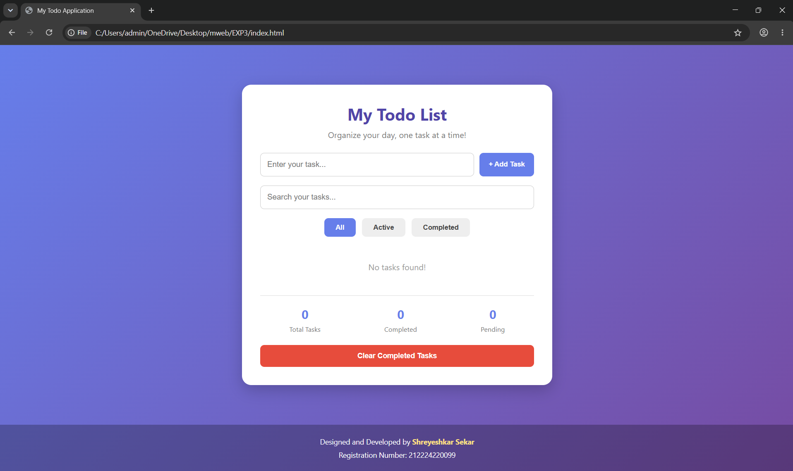
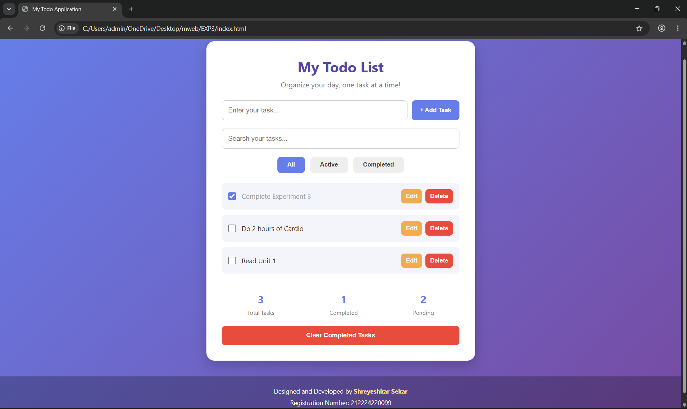

# Ex03 To-Do List using JavaScript
## NAME : SHREYESHKAR SEKAR
## REGISTRATION NUMBER : 212224220099
## Date: 06/11/2026

## AIM
To create a To-do Application with all features using JavaScript.

## ALGORITHM
### STEP 1
Build the HTML structure (index.html).

### STEP 2
Style the App (style.css).

### STEP 3
Plan the features the To-Do App should have.

### STEP 4
Create a To-do application using Javascript.

### STEP 5
Add functionalities.

### STEP 6
Test the App.

### STEP 7
Open the HTML file in a browser to check layout and functionality.

### STEP 8
Fix styling issues and refine content placement.

### STEP 9
Deploy the website.

### STEP 10
Upload to GitHub Pages for free hosting.

## PROGRAM:


index.html

```

<!DOCTYPE html>
<html lang="en">
<head>
    <meta charset="UTF-8">
    <meta name="viewport" content="width=device-width, initial-scale=1.0">
    <title>My Todo Application</title>
    <link rel="stylesheet" href="style.css">
</head>
<body>

    <div class="container">

        <div class="todo-box">

            <div class="header">
                <h1>My Todo List</h1>
                <p>Organize your day, one task at a time!</p>
            </div>

            <!-- Add Task -->
            <div class="input-section">
                <input type="text" id="taskInput"
                    placeholder="Enter your task...">
                <button id="addBtn" onclick="addTask()">
                    + Add Task
                </button>
            </div>

            <!-- Search -->
            <input type="text" id="searchInput"
                class="search-box"
                placeholder="Search your tasks..."
                oninput="displayTasks()">

            <!-- Filters -->
            <div class="filters">
                <button class="filter active"
                    onclick="setFilter('all', this)">All</button>

                <button class="filter"
                    onclick="setFilter('active', this)">Active</button>

                <button class="filter"
                    onclick="setFilter('completed', this)">Completed</button>
            </div>

            <!-- Task List -->
            <div id="taskList"></div>

            <!-- Task Statistics -->
            <div class="statistics">
                <div>
                    <h3 id="totalTasks">0</h3>
                    <p>Total Tasks</p>
                </div>

                <div>
                    <h3 id="completedTasks">0</h3>
                    <p>Completed</p>
                </div>

                <div>
                    <h3 id="pendingTasks">0</h3>
                    <p>Pending</p>
                </div>
            </div>

            <!-- Clear Button -->
            <button class="clear-btn" onclick="clearCompleted()">
                Clear Completed Tasks
            </button>

        </div>

    </div>

    <!-- Footer -->
    <footer>
        <p>Designed and Developed by <strong>Shreyeshkar Sekar</strong></p>
        <p>Registration Number: 212224220099</p>
    </footer>

    <script src="script.js"></script>

</body>
</html>

```

style.css

```

* {
    margin: 0;
    padding: 0;
    box-sizing: border-box;
}

body {
    font-family: 'Segoe UI', Arial, sans-serif;
    background: linear-gradient(135deg, #667eea, #764ba2);
    min-height: 100vh;
    display: flex;
    flex-direction: column;
}

/* Main Container */
.container {
    flex: 1;
    display: flex;
    justify-content: center;
    align-items: center;
    padding: 35px 15px;
}

/* Todo Box */
.todo-box {
    background: white;
    width: 100%;
    max-width: 600px;
    padding: 35px;
    border-radius: 18px;
    box-shadow: 0 10px 30px rgba(0,0,0,0.2);
}

/* Header */
.header {
    text-align: center;
    margin-bottom: 25px;
}

.header h1 {
    color: #5145a8;
    font-size: 32px;
    margin-bottom: 8px;
}

.header p {
    color: #777;
}

/* Input Section */
.input-section {
    display: flex;
    gap: 10px;
    margin-bottom: 18px;
}

.input-section input {
    flex: 1;
    min-width: 0;
    padding: 13px;
    border: 1px solid #ccc;
    border-radius: 8px;
    font-size: 15px;
    outline: none;
}

.input-section input:focus,
.search-box:focus {
    border-color: #667eea;
}

button {
    border: none;
    cursor: pointer;
    border-radius: 8px;
    font-weight: bold;
    transition: 0.3s;
}

button:hover {
    opacity: 0.85;
    transform: translateY(-1px);
}

#addBtn {
    background: #667eea;
    color: white;
    padding: 12px 18px;
}

/* Search */
.search-box {
    width: 100%;
    padding: 13px;
    border: 1px solid #ccc;
    border-radius: 8px;
    margin-bottom: 18px;
    font-size: 15px;
    outline: none;
}

/* Filters */
.filters {
    display: flex;
    justify-content: center;
    gap: 12px;
    margin-bottom: 22px;
}

.filter {
    padding: 10px 22px;
    background: #eee;
    color: #444;
}

.filter.active {
    background: #667eea;
    color: white;
}

/* Task Items */
.task-item {
    display: flex;
    align-items: center;
    gap: 12px;
    background: #f4f5fa;
    padding: 14px;
    border-radius: 9px;
    margin-bottom: 12px;
}

.task-item input[type="checkbox"] {
    width: 18px;
    height: 18px;
    cursor: pointer;
    accent-color: #667eea;
}

.task-text {
    flex: 1;
    overflow-wrap: anywhere;
    color: #333;
    font-size: 15px;
}

.task-text.completed {
    text-decoration: line-through;
    color: #999;
}

/* Edit and Delete */
.task-actions {
    display: flex;
    gap: 7px;
}

.edit-btn {
    background: #f0ad4e;
    color: white;
    padding: 8px 11px;
}

.delete-btn {
    background: #e74c3c;
    color: white;
    padding: 8px 11px;
}

.empty-message {
    text-align: center;
    color: #999;
    padding: 25px;
}

/* Statistics */
.statistics {
    display: flex;
    justify-content: space-around;
    text-align: center;
    border-top: 1px solid #ddd;
    margin-top: 20px;
    padding-top: 20px;
    gap: 10px;
}

.statistics h3 {
    color: #667eea;
    font-size: 23px;
}

.statistics p {
    color: #777;
    font-size: 13px;
    margin-top: 5px;
}

/* Clear Button */
.clear-btn {
    width: 100%;
    padding: 13px;
    margin-top: 22px;
    background: #e74c3c;
    color: white;
    font-size: 14px;
}

/* Footer */
footer {
    text-align: center;
    padding: 20px 10px;
    background: rgba(0,0,0,0.25);
    color: white;
    font-size: 14px;
    line-height: 1.8;
}

footer strong {
    color: #ffe082;
}

/* Mobile Responsive */
@media (max-width: 500px) {
    .todo-box {
        padding: 22px;
    }

    .header h1 {
        font-size: 26px;
    }

    .input-section {
        flex-direction: column;
    }

    #addBtn {
        padding: 13px;
    }

    .task-item {
        flex-wrap: wrap;
    }

    .task-actions {
        margin-left: auto;
    }

    .filter {
        padding: 9px 15px;
    }
}

```

script.js :

```

let tasks = JSON.parse(localStorage.getItem("tasks")) || [];

let currentFilter = "all";
let editId = null;

// Save tasks in Local Storage
function saveTasks() {
    localStorage.setItem("tasks", JSON.stringify(tasks));
}

// Add or Update Task
function addTask() {
    const input = document.getElementById("taskInput");
    const text = input.value.trim();

    if (text === "") {
        alert("Please enter a task!");
        return;
    }

    if (editId !== null) {
        tasks = tasks.map(task =>
            task.id === editId
                ? { ...task, text: text }
                : task
        );

        editId = null;
        document.getElementById("addBtn").textContent = "+ Add Task";

    } else {
        tasks.push({
            id: Date.now(),
            text: text,
            completed: false
        });
    }

    input.value = "";

    saveTasks();
    displayTasks();
}

// Display Tasks
function displayTasks() {
    const taskList = document.getElementById("taskList");
    const search = document.getElementById("searchInput")
        .value.toLowerCase();

    taskList.innerHTML = "";

    let filteredTasks = tasks.filter(task => {
        let matchesSearch = task.text.toLowerCase().includes(search);

        let matchesFilter =
            currentFilter === "all" ||
            (currentFilter === "active" && !task.completed) ||
            (currentFilter === "completed" && task.completed);

        return matchesSearch && matchesFilter;
    });

    if (filteredTasks.length === 0) {
        taskList.innerHTML =
            '<p class="empty-message">No tasks found!</p>';
    }

    filteredTasks.forEach(task => {
        const div = document.createElement("div");
        div.className = "task-item";

        const checkbox = document.createElement("input");
        checkbox.type = "checkbox";
        checkbox.checked = task.completed;
        checkbox.onchange = () => toggleTask(task.id);

        const span = document.createElement("span");
        span.className = task.completed
            ? "task-text completed"
            : "task-text";
        span.textContent = task.text;

        const actions = document.createElement("div");
        actions.className = "task-actions";

        const editButton = document.createElement("button");
        editButton.className = "edit-btn";
        editButton.textContent = "Edit";
        editButton.onclick = () => editTask(task.id);

        const deleteButton = document.createElement("button");
        deleteButton.className = "delete-btn";
        deleteButton.textContent = "Delete";
        deleteButton.onclick = () => deleteTask(task.id);

        actions.appendChild(editButton);
        actions.appendChild(deleteButton);

        div.appendChild(checkbox);
        div.appendChild(span);
        div.appendChild(actions);

        taskList.appendChild(div);
    });

    updateStatistics();
}

// Mark Task as Completed
function toggleTask(id) {
    tasks = tasks.map(task =>
        task.id === id
            ? { ...task, completed: !task.completed }
            : task
    );

    saveTasks();
    displayTasks();
}

// Edit Task
function editTask(id) {
    const task = tasks.find(task => task.id === id);

    document.getElementById("taskInput").value = task.text;

    editId = id;

    document.getElementById("addBtn").textContent = "Update Task";

    document.getElementById("taskInput").focus();
}

// Delete Task
function deleteTask(id) {
    if (confirm("Are you sure you want to delete this task?")) {
        tasks = tasks.filter(task => task.id !== id);

        saveTasks();
        displayTasks();

        if (editId === id) {
            editId = null;
            document.getElementById("taskInput").value = "";
            document.getElementById("addBtn").textContent = "+ Add Task";
        }
    }
}

// Filter Tasks
function setFilter(filter, button) {
    currentFilter = filter;

    document.querySelectorAll(".filter").forEach(btn => {
        btn.classList.remove("active");
    });

    button.classList.add("active");

    displayTasks();
}

// Clear Completed Tasks
function clearCompleted() {
    if (confirm("Delete all completed tasks?")) {
        tasks = tasks.filter(task => !task.completed);

        saveTasks();
        displayTasks();
    }
}

// Update Statistics
function updateStatistics() {
    const total = tasks.length;

    const completed = tasks.filter(
        task => task.completed
    ).length;

    const pending = total - completed;

    document.getElementById("totalTasks").textContent = total;
    document.getElementById("completedTasks").textContent = completed;
    document.getElementById("pendingTasks").textContent = pending;
}

// Enter Key Support
document.getElementById("taskInput").addEventListener("keydown", function(event) {
    if (event.key === "Enter") {
        addTask();
    }
});

// Initial Display
displayTasks();

```
## OUTPUT






## RESULT
The program for creating To-do list using JavaScript is executed successfully.
